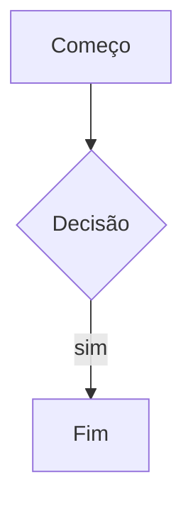

# Título de nível um

## Nível dois

### Nível três

#### Nível quatro

##### Nível cinco

###### Nível seis

Parágrafo comum com **negrito**, *itálico*, `código inline`, ==destaque==, ~~riscado~~ e um
[link externo](https://example.com). Uma frase longa o suficiente para quebrar linha em qualquer
largura de janela razoável, porque linha longa é o que mais aparece numa nota de verdade.

> Citação com [[Nota similar 1]] no meio e mais texto depois do link.
> Segunda linha da mesma citação.

> [!note] Nota
> Um callout de nota.

> [!tip] Dica
> Um callout de dica.

> [!warning] Cuidado
> Um callout de aviso.

> [!danger] Perigo
> Um callout de perigo.

> [!question] Pergunta
> Um callout de pergunta.

> [!example] Exemplo
> Um callout de exemplo.

> [!card]- Cartão com pergunta
> Resposta do cartão, com uma lacuna ==palavra== escondida.

- item solto
- item com **ênfase**
  - item aninhado
  - outro aninhado
    - terceiro nível
- [ ] tarefa pendente
- [x] tarefa feita

1. primeiro
2. segundo
3. terceiro
4. quarto
5. quinto

| Coluna curta | Uma coluna com nome bem mais longo | N | Outra |
|:--|:--|:-:|--:|
| a | texto médio na célula | 1 | 2 |
| b | um texto consideravelmente mais longo do que os outros para forçar a distribuição | 3 | 4 |
| c | curto | 5 | 6 |
| d | curto | 7 | 8 |
| e | curto | 9 | 10 |
| f | curto | 11 | 12 |
| g | curto | 13 | 14 |
| h | curto | 15 | 16 |
| i | curto | 17 | 18 |
| j | curto | 19 | 20 |
| k | curto | 21 | 22 |
| l | curto | 23 | 24 |
| m | curto | 25 | 26 |
| n | curto | 27 | 28 |
| o | curto | 29 | 30 |
| p | curto | 31 | 32 |
| q | curto | 33 | 34 |
| r | curto | 35 | 36 |
| s | curto | 37 | 38 |
| t | curto | 39 | 40 |
| u | curto | 41 | 42 |
| v | curto | 43 | 44 |

| Só duas | Células |
|:--|:--|
| x | y |

| Uma coluna estreitíssima | Uma coluna estreita | Uma coluna com um parágrafo inteiro dentro dela, que precisa quebrar em várias linhas sem partir palavra no meio |
|:--|:--|:--|
| 1 | 2 | este é o texto longo que testa a quebra por palavra, com palavras compridas como eletroencefalograficamente e outras nem tanto |

```rust
fn main() {
    println!("um bloco de código");
}
```



```query
tag: #qa
sort: titulo
```

```query
tag: #tag-depois-do-callout
sort: titulo
```

> [!danger] Perigo seguido de uma linha sem `>`
> O callout acaba na última linha com o marcador.
#tag-depois-do-callout e o texto que vem depois, fora da caixa.

Linha com emoji 🏥 🧭 ⏱ 👀 🔍 💊 e texto depois, para o caso de o glifo não existir.

Texto com %%um comentário do autor que não aparece na leitura%% e o resto da frase.

Uma palavra absurdamente longa para testar a quebra: pneumoultramicroscopicossilicovulcanoconiose.

[[Nota similar 1]] · [[Nota que não existe]] · [[Nota similar 2|um alias]] · [[Nota similar 3#Seção]]
· ![[Nota similar 1]] · ![[Nota similar 1#Seção]] · ![[figura-qa.png]]

Math em linha: $E = mc^2$ e em bloco:

$$
\int_0^1 x^2 dx = \frac{1}{3}
$$

---

Texto final, com footnote[^1] para ver o que acontece.

[^1]: O texto da footnote.
